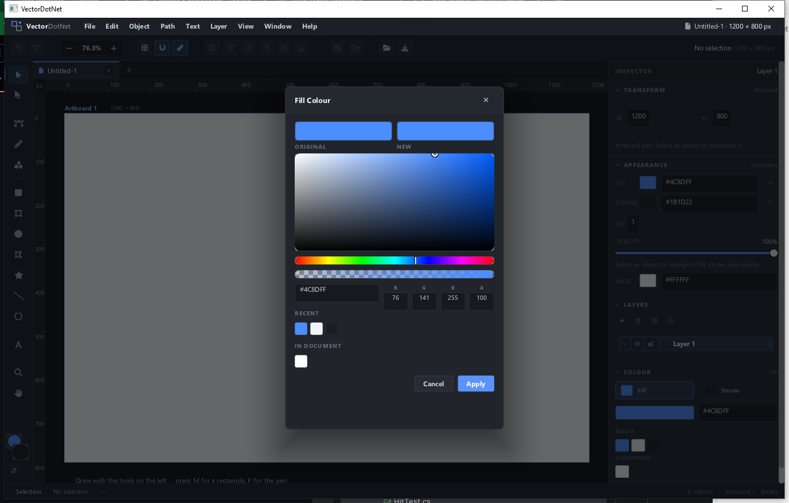
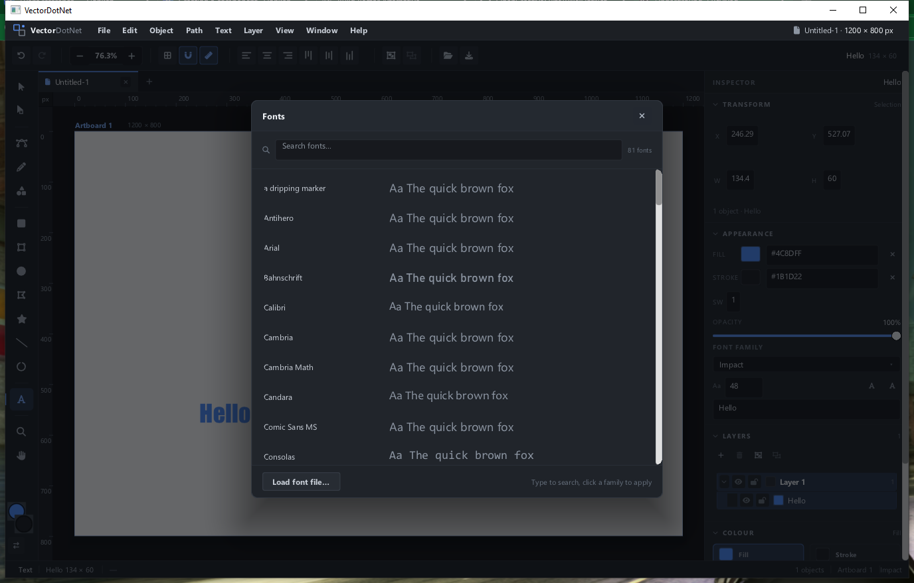
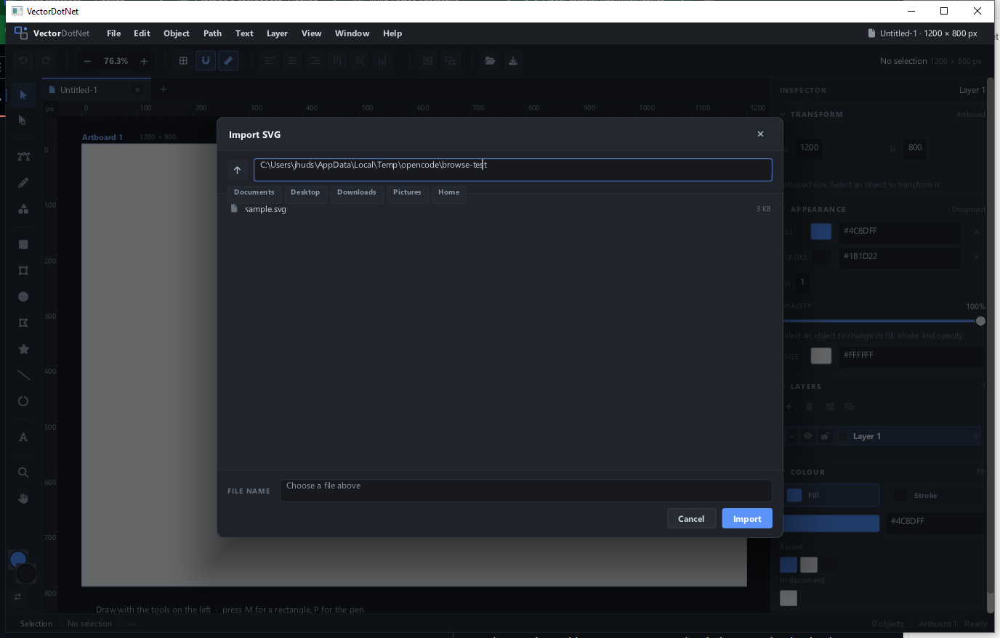
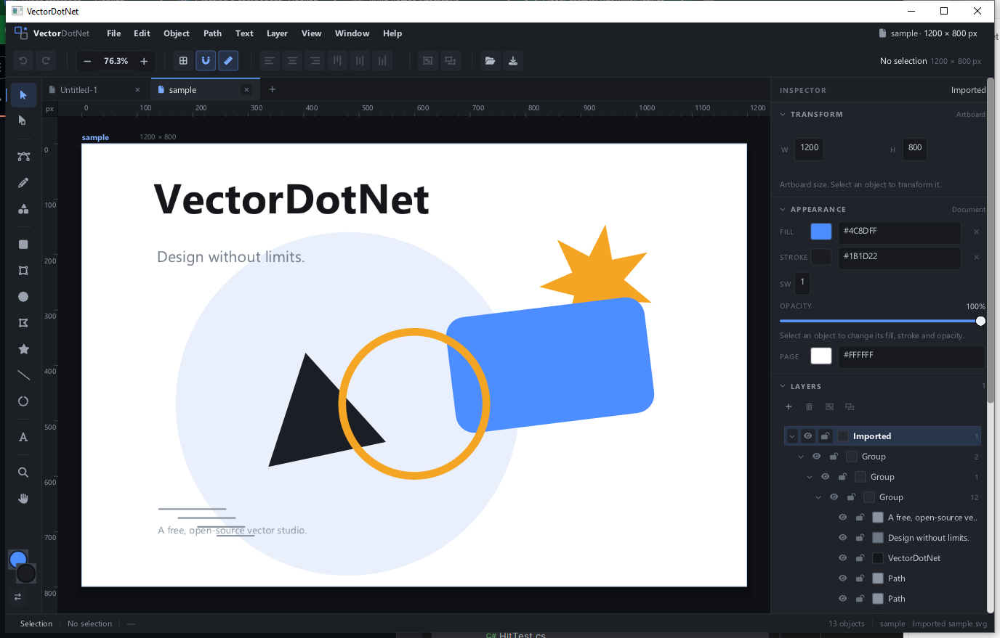
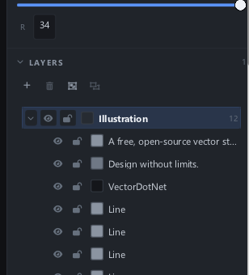
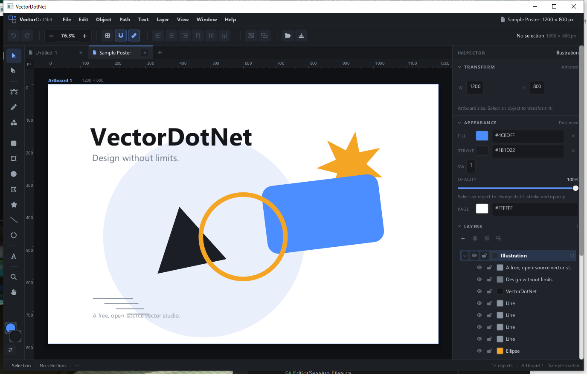

# VectorDotNet

**A free, open-source vector graphics studio for illustration, icons, logos and layout.** Draw real Bézier paths, shape them, style them and export clean SVG — without an account, a subscription, a cloud upload or a feature gate.

[](https://github.com/OpenCreativeSuite/VectorDotNet/releases/latest)
[](https://opencreativesuite.github.io/VectorDotNet/)


## A vector editor that gets out of the way

VectorDotNet is a desktop application built around the work designers actually do: drawing a logo, building an icon set, laying out a poster, or cleaning up an SVG from somewhere else.

It opens with a professional dark workspace — menu bar, contextual options, a focused tool rail, a large canvas and an inspector for the current selection. Documents open in tabs, each with its own view, selection and undo history.

- **Real vectors.** Curves remain curves at every zoom level. The document is a tree of paths, live shapes, groups, layers and artboards.
- **Everything included.** Every tool is available in the download. No paid tier, no watermark, no account.
- **Local by design.** Artwork is opened, edited and exported on your computer. No telemetry, no ads, no cloud folder.
- **SVG in and out.** Import an SVG as editable groups and paths; export a standards-compliant SVG or compressed SVGZ.
- **System fonts, plus your own.** Choose from every installed family with a live preview, or load a TTF, OTF, WOFF or WOFF2 file at runtime.

## What you can do with it

### Draw and shape

A pen with cubic anchors and mirrored handles, a smoothing pencil, a lasso, and live rectangles, rounded rectangles, ellipses, polygons, stars, lines and spirals. Live shapes keep their parameters, so a star can gain points or a rectangle can change corner radius long after it was drawn.

### Edit paths properly

Direct Selection edits anchors and Bézier handles. Delete nodes, convert live shapes to free paths, reverse path direction, and simplify dense paths with Douglas–Peucker. Nonzero and even-odd fill rules are supported, as are round, miter and bevel joins, caps, miter limits and dashed strokes.

### Organise a document

Nested groups and unlimited layers. Visibility and locking per object. Artboards with their own size and background. Object opacity, ordering, grouping, ungrouping, alignment and distribution. Multi-object selection with marquee, lasso and direct picking.

### Snap and align

Smart vertical and horizontal guides while moving, drawing and scaling. Snap to object edges and centres, artboard edges and centre, the grid, and guides dragged out of the rulers. Shift constrains movement and proportions.

### Colour and typography

A full colour picker with a saturation/value field, hue and alpha strips, HEX/RGB/alpha entry, live canvas preview, recent colours and an automatic palette from the document. Point text supports any installed family, size, bold and italic; the font picker is searchable and previews every family in its own face.

### Import, export and keep working

Import SVG and SVGZ into a new tab. Export the active artboard as SVG or SVGZ. The in-app file browser handles folders, shortcut places and save names without dropping to a platform dialog. Undo, redo, cut, copy, paste, duplicate and nudge all work across tabs.

## Made for everyday jobs

| I want to… | VectorDotNet can |
| --- | --- |
| Draw a logo | Pen tool + live shapes, then curve the nodes with Direct Selection |
| Keep a shape editable | Live shapes retain corner radius, point count, star ratio and spiral turns |
| Align a row of icons | Align to selection or artboard, distribute spacing, or use smart guides |
| Add a headline | Text tool with any installed family, plus runtime font file loading |
| Reuse a motif | Group, duplicate in place, or copy/paste between document tabs |
| Open someone else’s SVG | **File → Import SVG…** reads paths, arcs, groups, `<use>`, text and transforms |
| Hand off clean vectors | **File → Export SVG…** writes paths, strokes, dashes, transforms and text |
| Keep several designs open | Multi-document tabs, each with independent history and view |

## A look around

| Colour | Type | Files |
| --- | --- | --- |
|  |  |  |
| HSV field, hue/alpha strips, history and document colours. | Every installed family, previewed in its own face. | Browse folders and pick an SVG or font file in-app. |

| SVG import | Layers | Canvas |
| --- | --- | --- |
|  |  |  |
| Groups, paths, text and transforms stay editable. | Layer tree, visibility, locks and appearance in one place. | Artboards, rulers and a stable workspace. |

## Get started in a minute

1. **Download a build for your computer.** Windows, Linux and macOS builds are attached to the [latest release](https://github.com/OpenCreativeSuite/VectorDotNet/releases/latest). Unzip it and run `VectorDotNet` (`VectorDotNet.exe` on Windows). There is no installer.
2. **Try the sample.** Choose **File → Open Sample**. A poster opens in a new tab so you can drag a shape, move a node or change a colour straight away.
3. **Draw something.** Press <kbd>M</kbd> for a rectangle, <kbd>E</kbd> for an ellipse, or <kbd>P</kbd> for the pen. Hold <kbd>Shift</kbd> to constrain.
4. **Style it.** Click the fill or stroke swatch in the inspector to open the colour picker.
5. **Export it.** Press <kbd>Ctrl</kbd>+<kbd>Shift</kbd>+<kbd>E</kbd>, choose a folder and name in the file browser, and write an SVG.

## Run from source

You need the [.NET 10 SDK](https://dotnet.microsoft.com/download).

```sh
dotnet run
```

Or start the built `VectorDotNet` executable from `bin/`.

## Learn the app

The illustrated guide lives in [`docs/`](docs/index.html) and is published at:

**https://opencreativesuite.github.io/VectorDotNet/**

It covers features, a screenshot tour, a quick-start exercise, the full shortcut list and how to build from source.

## Project layout

```
Program.cs                     application root and session provider
src/Core/                      vector engine, document model, interactions, SVG, fonts
src/Components/                shell, canvas, inspector, pickers and dialogs
docs/                          user guide and screenshots
.github/workflows/             GitHub Pages and cross-platform release builds
```

The vector engine and document model are independent of the UI. Rendering is a custom anti-aliased scanline rasteriser; the canvas is one drawing surface, so zooming, panning and large documents stay responsive.

## Free and private

VectorDotNet is free to use and will stay free. There is no paid version, subscription, account, advertising or telemetry. Your documents are opened and saved on your computer. Loading a font file reads only the file you choose; there is no font service, cloud upload or external account.

## Project links

- [Latest release](https://github.com/OpenCreativeSuite/VectorDotNet/releases/latest)
- [User guide](https://opencreativesuite.github.io/VectorDotNet/)
- [Documentation source](docs/)
- [Website workflow](.github/workflows/pages.yml) and [release workflow](.github/workflows/release.yml)
- [Report an issue](https://github.com/OpenCreativeSuite/VectorDotNet/issues)
